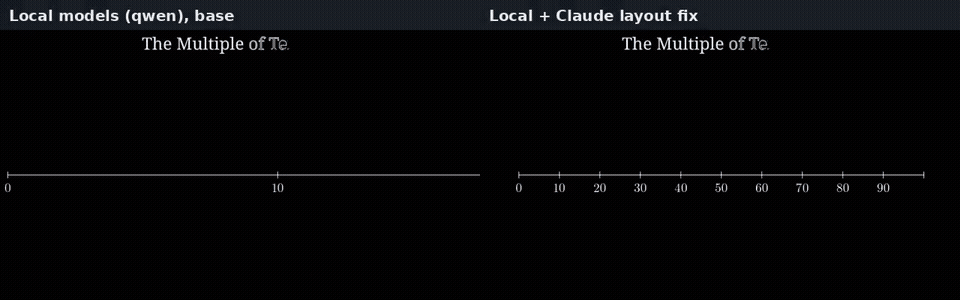
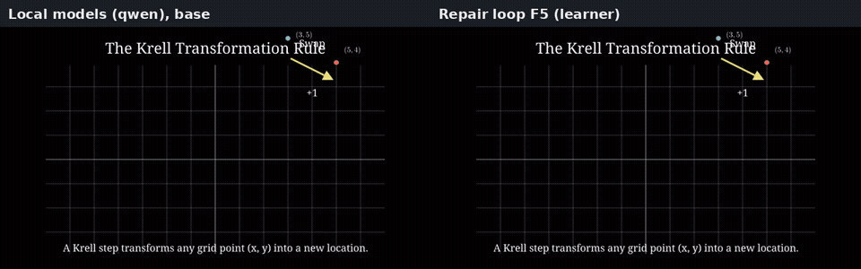
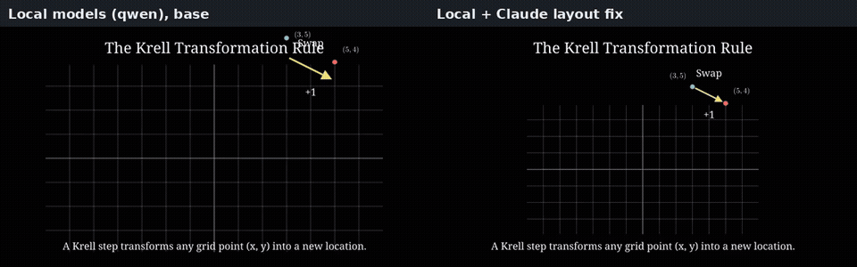
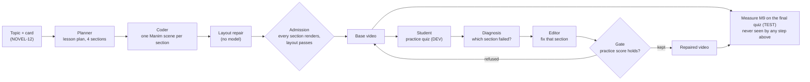
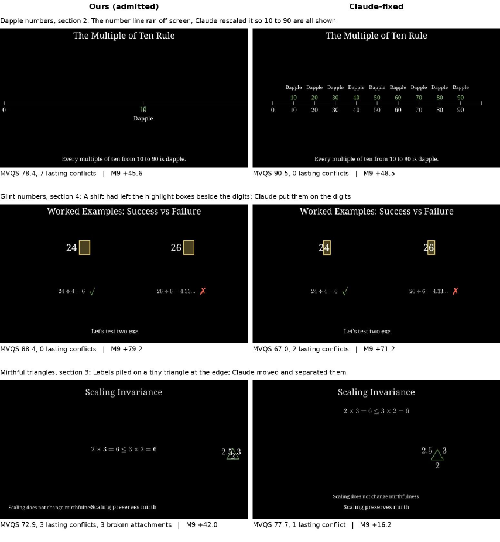

<div align="center">

# Does the Video Teach?

**Refusal, priors and repair in code-generated teaching videos**

[Paper (PDF)](paper/main.pdf) ·
[Technical report](paper/report.pdf) ·
[Long report for newcomers](paper/long_report.pdf) ·
[Demo gallery](demo/README.md) ·
[All videos (Google Drive)](DRIVE_LINK) ·
[Code (GitHub)](https://github.com/ManideepDonkena/Code2Video)

</div>

Computers can write short animated maths lessons as code (Manim). We tried to make such lessons teach better by
watching where a simulated student fails and fixing only that part of the video. Most of this work turned out to be
about **measuring** whether a video teaches at all. This repository holds the pipeline, the benchmark, the measures,
every study, and the reports.

<p align="center">
  <br>
  <em>The same lesson before and after a layout fix: in the base video every label piles onto the number 10.</em>
</p>

## What we found

| Question | Answer | Where |
|---|---|---|
| Does Code2Video's quiz score (TeachQuiz) see teaching? | **No, not on MMMC with our student.** The grader lost 52% of graded runs, the student refused instead of forgetting (85% "I don't know" with the video), and it already knew 99% of the answers. | Report §Step 0 |
| Can a better measure see it? | **Yes, on concepts the student cannot know.** On NOVEL-12, our measure M9 puts a topic's own video 64.4 points ahead of another topic's video, on 10 of 10 concepts. | Report §Steps 1–2 |
| Does the layout score see what a viewer sees? | **Barely.** Claude fixed 96 visible faults in 40 sections, and the score hardly moved. | Report §Layout |
| Does a cleaner layout teach more? | **Not clearly.** +5.1 points, on only 5 of 10 concepts. | Report §Layout |
| Does the student's feedback improve the video? | **Not shown.** The repair loop gave no gain beyond noise at any of its six stages (F0–F5). | Report §Step 3 |
| Does a stronger generator (Claude) make videos that teach more? | See [the generator study](bench/results/claude-gen/report.md). | Report §Generator study |

## Demo

Each row is one invented concept; each column is one way of making its video. Click a preview for the full video.
More comparisons, and every version of every video, are in the [demo gallery](demo/README.md).

| Comparison | Preview |
|---|---|
| **Repair loop (F5)** on *Krell steps on a grid*: base video, then the learner repair the gate kept. The edit adds teaching content; it does not fix layout, and here it added overlaps (5 → 11) |  |
| **Layout fix** on *Krell steps on a grid*: our layout, then Claude's fix (text unchanged) |  |

## How it works



One topic goes through six agents. Each is one model with one job; the full prompts are in the long report,
Appendix "The agents and their prompts" (generated from the code by `paper/make_prompts.py`).

| Agent | Model | Job |
|---|---|---|
| Planner | `qwen3.6` (or a Claude model in the generator study) | four-section lesson plan from the topic and, for an invented concept, its card |
| Coder | `qwen3-coder:30b` (or the same Claude model) | one Manim scene per section; repairs failing code line → block → scene (Code2Video's ScopeRefine) |
| Layout repair | no model (SGA's scene graph) | moves overlapping objects apart; kept only if the layout score rises |
| Practice-quiz writer | the planner | practice quiz (DEV) that drives the repair; never sees the final quiz |
| Student | `gemma4:26b` | answers the quiz from the video's frames only, told to forget the topic |
| Diagnosis and editor | the planner and the coder | find the section behind the student's mistakes and edit it (stages F0–F5) |

<p align="center"><br>
<em>Three frames the student saw: our video (left) and Claude's layout fix (right). The layout score (MVQS) and
what the student learned (M9) do not move together.</em></p>

## The benchmark: NOVEL-12

12 invented mathematical concepts that no model has seen, such as *Tovan sums* (a ⊕ b = a + b + ab). Each has a card
(definition, rules, one worked example) and 8 multiple-choice final-quiz questions (96 in all) whose answers are
computed by code. Without the video the student gets 41% right; with the card, 85%. So a gain can only come from the
video. Files: [`bench/novel/`](bench/novel/).

## The measure: M9

M9 is the gain in the student's confidence on the right answer after seeing 3 frames per section, against seeing
nothing. The student must pick a letter (no refusal), both option orders are asked, and only questions it did not
already know count. 100 means the video taught everything the student did not know. See `c2vlab/dvgain.py`.

## Install

```bash
# Python 3.10+ with manim (>= 0.19), numpy, scipy, Pillow; plus ffmpeg and Ollama
ollama pull qwen3.6 && ollama pull qwen3-coder:30b && ollama pull gemma4:26b && ollama pull qwen2.5vl:7b
# optional, for the Claude studies: a separate venv with the Anthropic SDK, and ANTHROPIC_API_KEY in an .env file
python -m venv .venv-claude && .venv-claude/bin/pip install anthropic
```

## Quick start

```bash
python run.py topic "Pythagoras theorem"                        # one topic, every condition, all local and free
python bench/run_bench.py --name novel12 --n 12 \
  --questions bench/novel/questions.json --cards bench/novel/cards.json   # NOVEL-12 base videos and the F0 loop
python bench/metric_ladder.py bench/results/novel12            # every version of the measure (M0–M9)
python bench/stages.py bench/results/novel12 --stage F5        # the repair loop with every feature
python bench/claude_gen.py --family sonnet                     # the generator study with a Claude model
python bench/make_showcase.py                                  # side-by-side videos and GIFs in demo/
paper/build.sh                                                 # every table, number and PDF
```

## Studies and their results

Each study writes its numbers to `bench/results/<study>/` (`report.md` for reading, `report.json` for the tables).

| Study | Script | Result |
|---|---|---|
| Pilot on 12 MMMC topics | `bench/run_bench.py` | [`mmmc-n12-seed0/`](bench/results/mmmc-n12-seed0/) |
| What the student already knows | `bench/mmmc_prior.py` | [`mmmc-prior-*.summary.json`](bench/results/) |
| Versions of the measure (MMMC) | `bench/metric_ladder.py` | [`mmmc-n12-seed0-ladder/`](bench/results/mmmc-n12-seed0-ladder/) |
| Versions of the measure (NOVEL-12) | `bench/metric_ladder.py` | [`novel12-ladder/`](bench/results/novel12-ladder/) |
| Layout side study | `bench/layout_study.py` | [`layout-study/`](bench/results/layout-study/) |
| Noise model (what counts as beyond noise) | `bench/noise_model.py` | [`noise-model/`](bench/results/noise-model/) |
| Repair loop, stages F0–F5 | `bench/stages.py` | [`novel12-stages/`](bench/results/novel12-stages/) |
| Generator study (local vs Claude) | `bench/claude_gen.py` | [`claude-gen/`](bench/results/claude-gen/) |

## Cost

All local runs are free (Ollama on our own GPUs). Paid API use, in tokens and dollars, is listed in the long report,
section "Cost of the studies", and every Claude request of the generator study is logged with its tokens and price.

## Repository

```
c2vlab/          the pipeline: generation, layout, quiz, student, measures, repair stages, model wrapper
bench/           benchmark data (MMMC, NOVEL-12) and one script per study; results in bench/results/
paper/           paper, technical report, long report; tables and numbers are generated (make_tables.py, make_prompts.py)
demo/            gallery: README, GIF previews, figures; full videos are on Google Drive
docs/            method, related work, benchmark protocol, models, open problems
```

## Acknowledgements

Built on [Code2Video](https://github.com/showlab/Code2Video) (pipeline, MMMC and TeachQuiz) and on SGA's scene graph for
layout. MMMC questions are MIT-licensed, from Code2Video.
